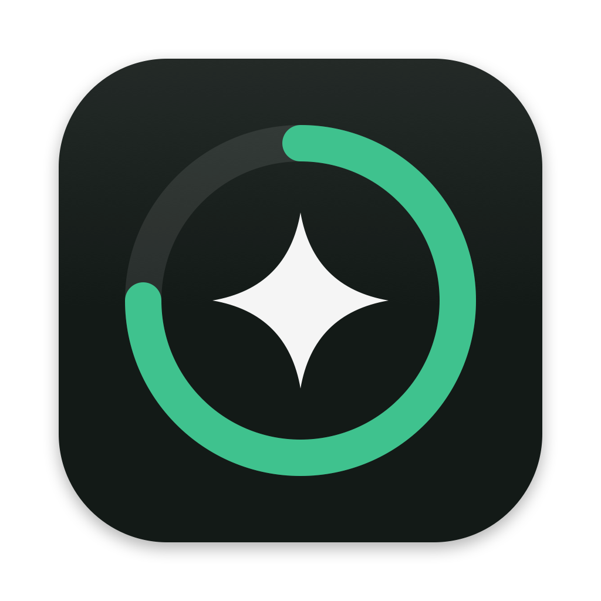

# MacSweep

A menu bar app that keeps a Mac's disk clean and shows what's slowing it down. Native SwiftUI, light on resources (about 0.15 % CPU when idle). The interface is in English and Czech, following the system language.

## What it does

**Menu bar**
- Free space at a glance, plus a one-click sweep. Each category (package-manager caches, Docker build cache, app caches, Xcode build data, old simulators and device symbols, Homebrew downloads, old logs, old Downloads, dependencies of idle projects) can be unticked, or expanded to untick single items.
- Dependencies of idle projects (`node_modules`, Python virtualenvs, Rust `target`) are looked for in your project folders. The common ones (`~/Github`, `~/Developer`, `~/Projects`…) are picked up on first launch; change them under ⋯ › Project Folders.
- Optional weekly sweep every Sunday at 10:00. It catches up if the Mac was asleep.
- Trash size, with a button to empty it.
- Vitals: CPU temperature and fan, CPU, memory, battery (including which apps drained it since unplugging), network and uptime.
- Warnings only when something is actually wrong: low disk space, space running out within two weeks at the current pace, a folder that grew 5 GB or more in a day, overheating, CPU busy for over a minute, or a Mac left running for weeks.
- How fast free space shrinks and roughly when it runs out, from hourly samples of the last 30 days.

**Shortcuts:** *Clean Up Mac* (returns the bytes freed) and *Free Disk Space* actions for Shortcuts, Spotlight and Siri.

**Main window**
- **Disk Analysis:** browse what takes up space, then move selected items to the Trash.
- **Files:** big files and duplicate files in your home folder (found through Spotlight), to move to the Trash.
- **Apps:** uninstall apps together with their leftovers. A preview lists every file before anything is removed.
- **Startup:** login items and background agents, with switches.
- **Advisor:** asks Claude to go through the disk, apps and processes and recommend what to clean up. It only reads; every recommendation links to the place in MacSweep where you act on it.
- The sidebar graphs free space over the last 30 days.

## Install

Download the DMG from [Releases](https://github.com/karlosmatos/MacSweep/releases/latest), open it and drag MacSweep to Applications. The app is signed with Developer ID and notarized, and it updates itself through Sparkle.

Requirements:
- macOS 14 or later
- [Mole](https://github.com/tw93/Mole) for Disk Analysis and Apps: `brew install mole`
- [Claude Code](https://docs.anthropic.com/en/docs/claude-code) CLI for the Advisor (optional)

On first use, macOS asks for these permissions:
- **Full Disk Access**, so folder sizes are complete. The app offers a shortcut to the setting.
- **Control of System Events**, to read and switch login items.

## Build from source

```sh
./build.sh
```

This builds the app, signs it, installs it to `/Applications` and launches it. It uses your Developer ID certificate if you have one, otherwise an Apple Development one, otherwise an ad-hoc signature.

| File | Purpose |
|---|---|
| `Sources/MacSweep/` | the app (SwiftPM, no Xcode project) |
| `scripts/disk-cleanup.sh` | the cleanup itself, bundled in the app; `--dry-run` prints what it would free |
| `scripts/generate_icon.swift` | draws `Resources/AppIcon.icns` |

## Translations

The source strings in the code are Czech and serve as keys; `Resources/en.lproj/Localizable.strings` maps them to English, which is also the fallback for every other system language. After adding or changing UI text, list the keys the compiler sees and add the missing ones to that file:

```sh
swift build -Xswiftc -emit-localized-strings -Xswiftc -emit-localized-strings-path -Xswiftc /tmp/loc
```

## Release

```sh
git tag v1.0.2
./scripts/release.sh
gh release create v1.0.2 build/MacSweep-1.0.2.dmg build/appcast.xml
```

`release.sh` builds a notarized DMG and the Sparkle `appcast.xml`. It needs:
- a Developer ID Application certificate
- a notarytool keychain profile named `AC_NOTARY`
- the Sparkle EdDSA key in the keychain under the account `macsweep`
